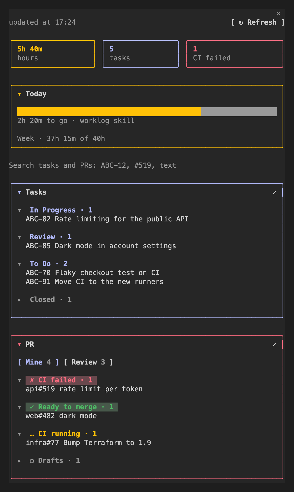
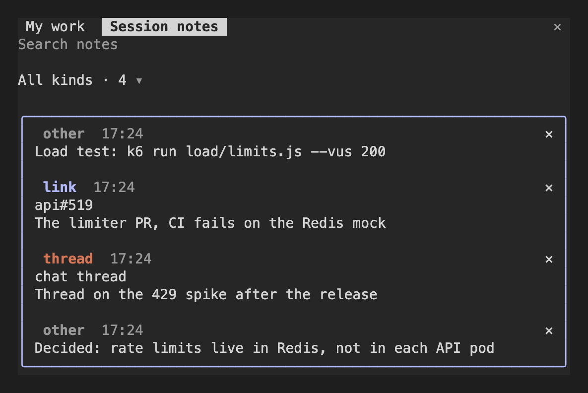

# session-companion

A Claude Code plugin that keeps your work beside the chat in two panes and one band above the prompt.

- **My work**: your Jira tasks in progress, your open PRs grouped by CI and review state, PRs waiting for your review, and the hours you logged today and this week.
  Each task and PR gets a button that opens the Code session it is worked on in.
- **Session notes**: links, chat threads, decisions and commands Claude saves as the session goes, so they do not get lost in the scroll.
- **Worklog skill**: builds a day's Jira worklog from your session transcripts and calendar, and logs it only after you confirm.
- **Setup skill**: walks you through the settings and shares them with your team.

Jira is optional: without it the work pane shows your PRs alone.

<table>
  <tr>
    <td valign="top"></td>
    <td valign="top"></td>
  </tr>
</table>

The panes in a terminal session with demo data; the desktop app draws them beside the chat.

## Install

At the prompt of a Claude Code terminal session:

```
/plugin install session-companion --marketplace MrGoln/session-companion
```

From a shell:

```bash
claude plugin install session-companion --marketplace MrGoln/session-companion
```

In the desktop app: click + next to the prompt box, then Plugins, Add marketplace with `MrGoln/session-companion`, then Add plugin.

Then ask Claude to "set up session companion".

### Your language

The panes speak English and react to English phrases ("let's start on ABC-12", "remember this").
To switch, ask Claude in your language, for example "set up session companion in German".
It writes your trigger phrases and the panes' text into your settings, so a plugin update keeps them.
A team can share one translation through its team file.

## Requirements

- macOS or Linux with Python 3.9 or newer as `python3`.
  Windows is not supported: `bin/jira.py` locks its cache with `fcntl`.
- The [GitHub CLI](https://cli.github.com/), signed in with `gh auth login`, for the PR list.
- For Jira: Jira Server or Data Center with a personal access token or API token.
  Jira Cloud is not supported: its search and worklog APIs differ.
- The token lives in the macOS Keychain; on Linux set `SESSION_COMPANION_JIRA_TOKEN`.

### Desktop app and terminal

The same plugin runs in both.
In the desktop app the panes sit beside the chat; in a terminal session (`claude`) they open as tabs on the right.
Linking a session to a task (`/task`, `link_task`) and the ↗ buttons that open a session need the desktop app, since they use its session list; everything else works in the terminal too.

## Use

| You do | What happens |
| --- | --- |
| Click **▸ My work** above the prompt, or `/work` | The work pane opens; it refreshes every 10 minutes and on **↻ Refresh** |
| `/task ABC-123`, or say "let's start on ABC-123" | This session is linked to the task; the task gets a button back to it |
| Click **▸ Notes**, or `/notes` | The notes pane opens |
| `/note text and a link`, or "remember this: …" | A note is saved for this session |
| "log my time for today" | The worklog skill proposes a table and logs it after your yes |

Claude gets the tools `add_note` and `show_notes`, and `link_task` once Jira is set up.
It saves notes on its own when a PR, issue, wiki page or chat thread comes up.

## Settings

Two JSON files, merged key by key over the defaults:

1. A **team file** the team keeps in a shared repository: Jira url and time zone, the PR search scope, chat thread patterns, the team's worklog guide.
2. Your **personal file**, `~/.claude/session-companion/config.json`: its `team` points at the team file, and its values win.

```json
{
  "team": "~/work/handbook/session-companion/team.json",
  "jira": { "login": "jdoe" },
  "worklog": { "cwdDefaults": { "acme-api": "ABC-101" } }
}
```

| Key | Default | Meaning |
| --- | --- | --- |
| `jira.url` | empty | Jira base url; empty turns Jira off |
| `jira.login` | OS user | Jira login, also the Keychain account |
| `jira.timezone` | `local` | The zone Jira stamps worklogs in, as `+02:00` |
| `jira.myTasksJql` | open tasks assigned to you | What the Tasks card lists |
| `jira.projects` | any key | Project keys the worklog skill looks for in transcripts |
| `github.search` | all of GitHub | Added to every PR search, as `org:acme` |
| `github.shortenRepos` | none | Name prefixes cut in narrow rows |
| `workday.hours` | `8` | A full day in the hours bar |
| `notes.threadUrls` | Slack permalinks | Regexes for links saved as chat threads |
| `language.startWords` | English phrases | JavaScript regexes for "let's start on": the issue key after one links the session |
| `language.rememberWords` | English phrases | JavaScript regexes for "remember this": Claude saves a note |
| `language.text` | none | The panes' English text mapped to yours; `python3 bin/texts.py` lists every text |
| `worklog.guide` | none | The team's worklog guide, Markdown |
| `worklog.personalGuide` | `~/.claude/session-companion/worklog.md` | Your own buckets and meetings |
| `worklog.cwdDefaults` | none | A folder path part mapped to an issue, the last resort |

Full examples are in [`examples/`](examples/).

The Jira token never goes in a file:

```bash
security add-generic-password -U -s session-companion-jira -a <login> -w
```

or `export SESSION_COMPANION_JIRA_TOKEN=...` outside macOS.

## Data

- Notes: `~/.claude/session-companion/notes/<session>.json`, one file per session, at most 200 notes each.
- Jira answers: a SQLite cache in `~/.claude/session-companion/`, shared by every open session so they ask Jira once per 10 minutes together.
- A token Jira refused over Basic auth is remembered by its hash and not sent again, so repeated failures do not lock the account.

## What it can access

Read this before installing: a mod runs with your rights.

- **Processes**: `gh api graphql` for your PRs, `python3 bin/jira.py` for Jira and the settings, `date +%z` for the time zone, `/usr/bin/open` (`xdg-open` on Linux) for a session button you click.
- **Network**: only `gh` (GitHub) and `bin/jira.py` (the `jira.url` you set); the mod itself sends nothing elsewhere.
- **Secrets**: the Jira token from `$SESSION_COMPANION_JIRA_TOKEN` or the macOS Keychain item `session-companion-jira`; it is never written to a file.
- **Files**: writes only under `~/.claude/session-companion/`; the worklog skill reads session transcripts in `~/.claude/projects/`.
- **App**: the desktop app's `get_session` and `list_sessions` tools, to link a session to a task and show its title.
- **Jira writes**: the panes only read Jira; the worklog skill adds worklogs and creates or edits ops issues, each only after you confirm.

## Develop

```bash
claude plugin validate .
claude plugin test .
python3 -m unittest discover -s tests -p 'test_*.py'
```

Run a session with the plugin from this folder: `claude --plugin-dir .`.
It also writes the engine's types to `.claude-plugin/types/`, which `tsc -p .` needs.

## License

MIT
